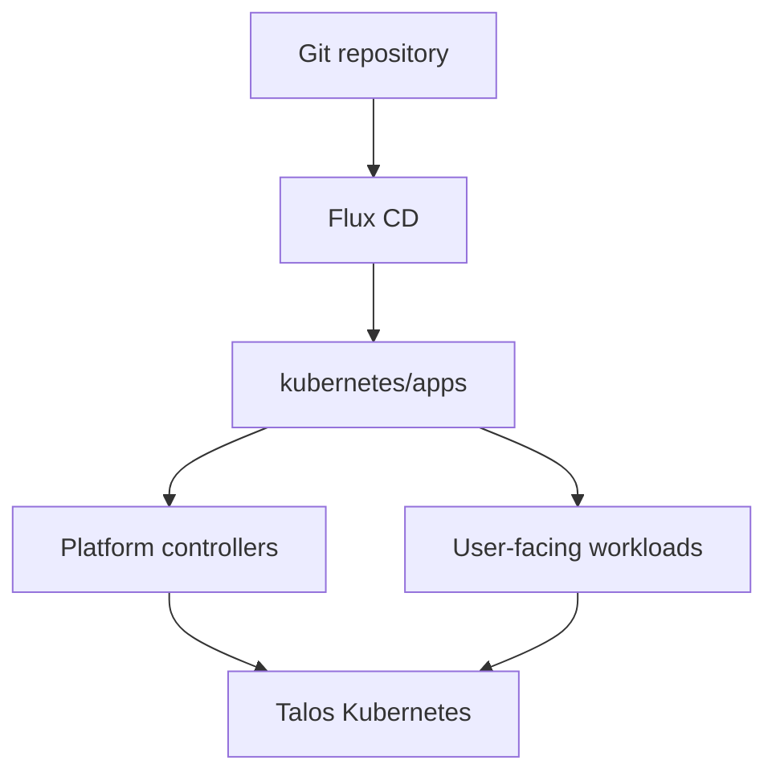

<div align="center">

# Eudald's Homelab

_GitOps-managed home infrastructure powered by Talos, Kubernetes, OpenTofu, Flux CD, and Cilium._

</div>

<div align="center">

[](https://status.eudald.gr)&nbsp;&nbsp;
[](https://cadi-gatus.eudald.gr)

</div>

<div align="center">

[](https://talos.dev)&nbsp;&nbsp;
[](https://kubernetes.io)&nbsp;&nbsp;
[](https://fluxcd.io)&nbsp;&nbsp;
[](https://github.com/eudaldgr/homelab/actions/workflows/renovate.yaml)

</div>

<div align="center">

[](https://github.com/home-operations/kromgo)&nbsp;&nbsp;
[](https://github.com/home-operations/kromgo)&nbsp;&nbsp;
[](https://github.com/home-operations/kromgo)&nbsp;&nbsp;
[](https://github.com/home-operations/kromgo)&nbsp;&nbsp;
[](https://github.com/home-operations/kromgo)&nbsp;&nbsp;
[](https://github.com/home-operations/kromgo)&nbsp;&nbsp;
[](https://github.com/home-operations/kromgo)&nbsp;&nbsp;
[](https://github.com/home-operations/kromgo)

</div>

---

## Overview

This repository is the source of truth for my homelab: bare-metal Talos nodes,
bootstrap, Kubernetes platform controllers, applications, secrets, backups, DNS,
and selected services that still run outside the cluster.

The operating model is deliberately boring:

1. Talos runs Kubernetes directly on bare metal, configured from `talos/`.
1. A one-shot helmfile bootstrap (`bootstrap/`) installs the minimum Flux needs.
1. Flux CD reconciles the desired state from `kubernetes/`.
1. Controllers handle networking, storage, certificates, databases, policy, and backups.

---

## Kubernetes

The active cluster is a three-node, control-plane-only Talos Kubernetes
deployment on bare metal.

| Node    | Hardware                 | CPU       | RAM  | System / Miroir | Ceph OSD | NIC                 |
| ------- | ------------------------ | --------- | ---- | --------------- | -------- | ------------------- |
| `k8s-0` | Dell OptiPlex 3080 Micro | i5-10500T | 64GB | NVMe            | SATA SSD | RTL8125B 2.5GbE     |
| `k8s-1` | HP ProDesk 400 G5 Mini   | i5-9500T  | 32GB | NVMe            | SATA SSD | Intel I226-V 2.5GbE |
| `k8s-2` | Dell OptiPlex 3050 Micro | i5-7500T  | 24GB | NVMe            | SATA SSD | RTL8125B 2.5GbE     |

The Kubernetes API is exposed at `https://k8s.eudald.gr:6443`. `mise` exports
`KUBECONFIG` and `TALOSCONFIG` pointing at the repository root:

```bash
kubectl get nodes -o wide
flux get kustomizations -A
```

The `Targets` badge counts Prometheus scrape targets that are currently up. It
is a monitoring signal, not a count of pods or public services.

### Core Components

| Area                     | Components                                                                           |
| ------------------------ | ------------------------------------------------------------------------------------ |
| GitOps                   | Flux CD, Kustomize, Helm Controller                                                  |
| Networking               | Cilium, Gateway API, LB IPAM, BGP, L2 announcement, ExternalDNS with AdGuard webhook |
| Ingress and tunnels      | HTTPRoute, TLS passthrough, Pocket ID, Newt/Pangolin                                 |
| Secrets                  | Infisical and SOPS for local encrypted files                                         |
| Storage                  | Rook Ceph on SATA SSDs, Miroir (DRBD) on NVMe, NFS for selected shared data          |
| Databases                | CloudNativePG with barman-cloud ObjectStore backups                                  |
| Backups                  | Kopiur volume snapshots and CloudNativePG object-store backups                       |
| Observability and policy | kube-prometheus-stack, Hubble, Falco, Gatekeeper, Kyverno                            |

---

## GitOps

Flux bootstraps from `kubernetes/flux/cluster` and reconciles the platform and
applications under `kubernetes/apps`. Each deployable component owns a leaf
`Kustomization` and its manifests.

```bash
flux get sources git -A
flux get kustomizations -A
kustomize build kubernetes/apps/network/omada/app
```



---

## Infrastructure

The cluster is built in three steps, all driven by `just`:

| Step      | Path          | Responsibility                                                                                         |
| --------- | ------------- | ------------------------------------------------------------------------------------------------------ |
| Talos     | `talos/`      | Machine config rendered per node, secrets resolved from Infisical                                      |
| Bootstrap | `bootstrap/`  | Talos apply + etcd bootstrap, CRDs, Cilium, CoreDNS, Spegel, cert-manager, Infisical operator and Flux |
| GitOps    | `kubernetes/` | Everything else, reconciled by Flux                                                                    |

```bash
just talos download-image v1.14.2   # metal ISO for the shared schematic
just talos apply-node k8s-0         # render and apply a node config
just bootstrap cluster              # bootstrap Talos, Kubernetes and Flux end to end
```

Additional infrastructure lives in:

- `tofu/backblaze/homelab/` for backup buckets.
- `tofu/hetzner/homelab/` for Hetzner resources.
- `ansible/` for host preparation.
- `compose/ds920plus/prod/` for Compose workloads managed around Komodo and Pangolin.

---

## Repository

```text
.
├── ansible/      # Host preparation for container hosts, Komodo, and Pangolin
├── compose/      # Compose stacks for ds920plus, split into prod and archive
├── coreboot/     # Coreboot firmware work
├── komodo/       # Komodo resources: servers, repos, syncs, actions, builders
├── kubernetes/   # Kubernetes desired state reconciled by Flux CD
├── packer/       # Packer templates and variables
├── scripts/      # Local operator helpers
├── secrets/      # Sensitive material
└── tofu/         # OpenTofu stacks and modules
```

---

## Operations

Useful read-only checks:

```bash
flux get kustomizations -A
kubectl get gateway,httproute -A -o wide
kubectl get storageclass,pvc -A
kubectl get clusters.postgresql.cnpg.io -A -o wide
kubectl get snapshotschedules.kopiur.home-operations.com -A
```

Talos configs are validated before applying them:

```bash
just talos render-config k8s-0 | talosctl validate --strict --mode metal --config /dev/stdin
```

---

## Safety

This repository controls real infrastructure.

- Prefer GitOps over manual cluster mutation.
- Treat `./deploy` as unsafe notes, not as a normal deployment command.
- Do not commit plaintext secrets, kubeconfigs, private keys, tfstate, or local environment files.
- Do not modify encrypted secret material unless that is the explicit task.

---

## Inspiration

The layout is inspired by the home-operations community, especially repositories
that keep infrastructure understandable by making the current state visible at a
glance. The implementation here is tailored to this cluster's actual Proxmox,
Talos, Cilium, Proxmox CSI, Flux CD, Kopiur, and Compose setup.
